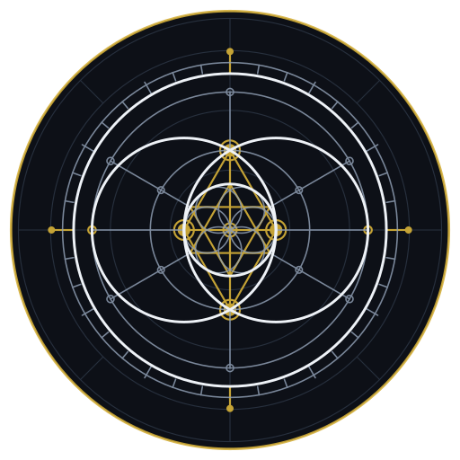

:site_title: Proclus Diadochus

.. container:: author-overline

   semantic digital archive • the works of

=================
Proclus Diadochus
=================

:person:`Proclus Diadochus <proclus>` (412–485 CE), Neoplatonic head of the Athenian Academy, composed the richest surviving ancient philosophy of mathematics in his commentary on the first book of Euclid's *Elements*. Here his prologues, axiomatic inquiries, Eudemian history of early Greek geometry, and proposition-by-proposition commentary appear in synchronized English and Greek tracks paired with Friedlein folio citations and calibrated diagrams.

Works in This Archive
---------------------

.. container:: home-book-hero

   .. container:: home-book-thumb

      .. image:: in_euclidem/propositions/01/0255.g1.svg
         :alt: Equilateral triangle construction (Euclid Book I, Proposition 1)
         :target: in_euclidem/index.html

   .. container:: home-book-body

      .. rubric:: Friedlein 1873 & Taylor 1792 · Prologues · Principles · Propositions I.1–I.48

      **Commentary on the First Book of Euclid's Elements (*In Primum Euclidis*)** — Surveys the nature of mathematical imagination and geometric proof in two sweeping Prologues, analyzes Euclid's definitions, postulates, and common notions, and comments across all 48 propositions of Book I with **133 calibrated vector figures**.

      .. container:: home-actions

         * :doc:`Open the Commentary → <in_euclidem/index>`
         * :doc:`Prologue I (Philosophy) → <in_euclidem/prologue-1/index>`
         * :doc:`Proposition I.1 → <in_euclidem/propositions/01/index>`

Key Features
------------

.. container:: home-feature-grid

   .. container:: home-feature-card

      **Synchronized Four-Track Codex**

      Read every prologue, definition, postulate, and proposition side by side across **English**, Friedlein's critical **Greek**, **Summary**, and primary-source **Notes** tracks.

   .. container:: home-feature-card

      **164 Friedlein Citation Loci**

      Trace every ancient historical fragment and philosophical citation through the :doc:`Friedlein Concordance <in_euclidem/concordance>`, linking directly across ``euclid`` and ``hoenen``.

   .. container:: home-feature-card

      **133 Calibrated Vector Diagrams**

      Interactive `.euclid-graphic` SVGs illuminate Proclus's geometric cases, converses, and auxiliary constructions throughout Book I.

Reference & Project
-------------------

.. container:: home-columns

   .. container:: home-col

      .. rubric:: Scholarly Apparatus

      * :doc:`People <in_euclidem/people/index>` — Prosopographical register of 54 geometers and philosophers, including the Eudemian Summary
      * :doc:`Friedlein Concordance <in_euclidem/concordance>` & :doc:`Bibliography <in_euclidem/bibliography>` — Canonical Friedlein pagination and critical editions
      * :doc:`Glossary <in_euclidem/glossary>` — Lexicon of 44 Neoplatonic and Euclidean terms

   .. container:: home-col

      .. rubric:: About This Project

      * :doc:`About <about/index>` — Scope, sources, and editorial methodology
      * :doc:`Using This Edition <usage/index>` — Reading guide, track switching, and diagram controls
      * :doc:`Log <log/index>`, :doc:`Changelog <changelog>`, & :doc:`Modules <modules/index>` — Journal, release history, and package reference

.. toctree::
   :hidden:
   :maxdepth: 2

   in_euclidem/index
   about/index
   usage/index
   log/index
   changelog
   modules/index
